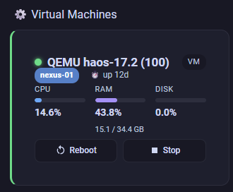

# Proxmox Guest Card

A compact [Home Assistant](https://www.home-assistant.io/) Lovelace card for a single **Proxmox VE guest** (VM or LXC), built for the [proxmoxve](https://www.home-assistant.io/integrations/proxmoxve/) integration.



Shows status, which node it's running on, uptime, and CPU / RAM / Disk usage — with raw GB values, not just percentages — plus working **Start / Stop / Reboot** buttons.

## Why

The `proxmoxve` integration gives you dozens of sensor entities per guest, but no native card to actually look at them. This card takes one entity (the guest's status sensor) and auto-derives everything else — no manual entity wiring per card.

## Features

- 🟢 Live running/stopped status with a colored border that reflects overall health (green/orange/red based on CPU, RAM, and Disk usage)
- 🖥️ Auto-colored node badge — consistent color per Proxmox node, no configuration needed
- ⏱️ Relative uptime ("up 12d") or "stopped"
- 📊 CPU / RAM / Disk gauges, with raw GB shown under RAM and Disk when the corresponding `_memory_total` / `_disk_total` sensors are enabled
- ▶️ ⏹️ 🔄 Real Start / Stop / Reboot buttons wired to the integration's own `button.*` entities
- Click the card body to open the entity's more-info dialog

## Installation

### HACS (custom repository)

1. HACS → Frontend → ⋮ → Custom repositories
2. Add this repository URL, category: **Lovelace**
3. Install **Proxmox Guest Card**
4. Add the resource if HACS doesn't do it automatically (Settings → Dashboards → Resources)

### Manual

1. Download `proxmox-guest-card.js`
2. Copy it to `/config/www/`
3. Add as a dashboard resource: `/local/proxmox-guest-card.js`, type: JavaScript Module

## Usage

Minimal config — the card figures out the rest from the entity name:

```yaml
type: custom:proxmox-guest-card
entity: binary_sensor.lxc_plex_101_status
```

### All options

```yaml
type: custom:proxmox-guest-card
entity: binary_sensor.lxc_plex_101_status   # required — the guest's status binary_sensor
name: Plex Media Server                      # optional — overrides the auto-derived name
show_disk: true                              # optional — set false to hide the Disk gauge
show_actions: true                           # optional — set false to hide Start/Stop/Reboot
cpu_entity: sensor.custom_cpu_entity          # optional — override auto-derived CPU entity
ram_entity: sensor.custom_ram_entity          # optional — override auto-derived RAM entity
disk_entity: sensor.custom_disk_entity        # optional — override auto-derived Disk entity
```

### Raw GB values

To see actual GB used/total (not just %), enable these disabled-by-default entities per guest in Home Assistant (Settings → Devices & Services → Proxmox VE → the guest device → enable):

- `sensor.<guest>_memory_total`
- `sensor.<guest>_disk_total`

The card picks them up automatically once enabled — no config change needed.

## Roadmap / v2

Proxmox's own memory metric includes reclaimable disk cache, which can make RAM usage look much higher than actual memory pressure. **v2 will add an optional [Beszel](https://beszel.dev/) data source** for true in-guest memory pressure, real per-core CPU, and disk I/O — for anyone already running Beszel alongside Proxmox.

## License

MIT — see [LICENSE](LICENSE).

## Author

Karam Harricharan
